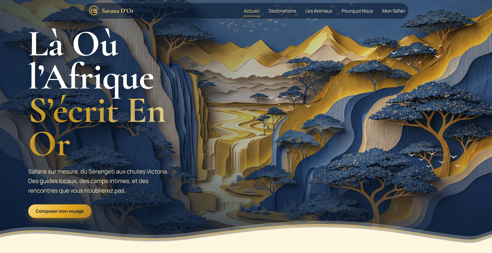

<div align="center">

# Savana D’Or

**Là où l’Afrique s’écrit en or.**
Site vitrine d’une agence de safaris sur mesure en Afrique : Tanzanie, Kenya, Botswana, Zambie, Namibie.

[](https://nextjs.org/)
[](https://react.dev/)
[](https://www.typescriptlang.org/)
[](https://nodejs.org/)

[Voir le site en ligne](https://savana-dor.vercel.app/) · [Code source](https://github.com/Dravix89/savana-dor)



</div>

---

## Sommaire

- [Présentation](#présentation)
- [Liens](#liens)
- [Fonctionnalités](#fonctionnalités)
- [Pages du site](#pages-du-site)
- [Stack technique](#stack-technique)
- [Structure du projet](#structure-du-projet)
- [Démarrage rapide](#démarrage-rapide)
- [Scripts disponibles](#scripts-disponibles)
- [Personnaliser le site](#personnaliser-le-site)
- [Design system](#design-system)
- [Responsive](#responsive)
- [Accessibilité et performance](#accessibilité-et-performance)
- [Pistes d’amélioration](#pistes-damélioration)
- [Crédits](#crédits)
- [Auteur](#auteur)

---

## Présentation

**Savana D’Or** est un site vitrine 100 % responsive (desktop, tablette, mobile) pour une agence de safaris sur mesure. Le design repose sur une palette or, sable et bleu nuit, des vagues SVG entre les sections, des titres en Cormorant Garamond et une navigation flottante en verre dépoli.

Le projet est une migration d’un site HTML statique vers **Next.js (App Router)** et **TypeScript**, avec des composants réutilisables, un CSS global et un CSS dédié à chaque page.

## Liens

| Ressource    | URL                                    |
| ------------ | -------------------------------------- |
| Dépôt GitHub | https://github.com/Dravix89/savana-dor |
| Auteur       | https://github.com/Dravix89            |

## Fonctionnalités

- **5 pages** : accueil, destinations, animaux, pourquoi nous, mon safari.
- **Navigation flottante** avec lien actif, effet de verre au scroll et **menu hamburger** sous 900 px (fermeture avec Échap ou au clic).
- **Héros avec parallaxe** douce sur l’image de fond et volées d’oiseaux en SVG.
- **Vagues SVG** (`Wave`) entre chaque section : 4 formes (`swell`, `ripple`, `dune`, `crest`), 3 couches translucides et un filet doré.
- **Cartes animaux interactives** : clic, toucher ou clavier (Entrée, Espace) pour révéler où et quand les observer.
- **Compteurs animés** sur la page « Pourquoi nous », déclenchés à l’apparition à l’écran.
- **Bouton de retour en haut** avec anneau de progression du scroll, aux couleurs du site.
- **Footer enrichi** : marque, réseaux sociaux, navigation, destinations, contact et inscription à la newsletter.
- **Formulaire « Composer mon safari »** avec message de confirmation.
- **Images optimisées** avec `next/image` (source Unsplash).
- **Polices auto-hébergées** avec `next/font` (Cormorant Garamond et Manrope).
- **Mode sombre** automatique selon les préférences du système.
- Respect de `prefers-reduced-motion`.

## Pages du site

| Route            | Fichier                      | Contenu                                                                              |
| ---------------- | ---------------------------- | ------------------------------------------------------------------------------------ |
| `/`              | `app/page.tsx`               | Héros, 5 destinations, grille des animaux, approche sur mesure, citation, expérience |
| `/destinations`  | `app/destinations/page.tsx`  | Les 5 destinations, art de voyager, paysages, itinéraire en 3 étapes                 |
| `/animaux`       | `app/animaux/page.tsx`       | Les rencontres, observer sans déranger, écosystèmes, préparation                     |
| `/pourquoi-nous` | `app/pourquoi-nous/page.tsx` | Chiffres clés, approche, philosophie, valeurs, accompagnement                        |
| `/mon-safari`    | `app/mon-safari/page.tsx`    | Formulaire de demande, inspirations, déroulé en 3 temps                              |

## Stack technique

| Technologie                                   | Version            | Rôle                                        |
| --------------------------------------------- | ------------------ | ------------------------------------------- |
| [Next.js](https://nextjs.org/)                | 16.4.6             | Framework React, App Router, rendu statique |
| [React](https://react.dev/)                   | 19.3.1             | Interface                                   |
| [TypeScript](https://www.typescriptlang.org/) | ^5.9.0             | Typage                                      |
| [Node.js](https://nodejs.org/)                | 22 LTS (conseillé) | Environnement d’exécution                   |
| CSS global + CSS Modules                      | -                  | Styles (aucune librairie CSS externe)       |
| `next/font`                                   | inclus             | Cormorant Garamond, Manrope                 |
| `next/image`                                  | inclus             | Optimisation des images                     |

Dépendances de développement : `@types/node` ^22, `@types/react` ^19, `@types/react-dom` ^19.

## Structure du projet

```text
savana-dor/
├── app/
│   ├── layout.tsx              # Layout racine : polices, métadonnées, Navbar, Footer, ScrollUp
│   ├── globals.css             # Variables, base, héros, blocs éditoriaux partagés, responsive
│   ├── favicon.ico             # Favicon du site
│   ├── page.tsx                # Accueil
│   ├── page.module.css         # Styles propres à l’accueil
│   ├── destinations/
│   │   ├── page.tsx
│   │   └── page.module.css
│   ├── animaux/
│   │   ├── page.tsx
│   │   └── page.module.css
│   ├── pourquoi-nous/
│   │   ├── page.tsx
│   │   └── page.module.css
│   └── mon-safari/
│       ├── page.tsx
│       └── page.module.css
├── components/
│   ├── Navbar.tsx              # Navigation flottante + menu hamburger
│   ├── Navbar.module.css
│   ├── Footer.tsx              # Footer enrichi
│   ├── Footer.module.css
│   ├── Newsletter.tsx          # Inscription newsletter (client)
│   ├── ScrollUp.tsx            # Bouton retour en haut avec progression
│   ├── ScrollUp.module.css
│   ├── Wave.tsx                # Vagues SVG de séparation
│   ├── Wave.module.css
│   ├── Hero.tsx                # Héros : parallaxe + oiseaux
│   ├── birds.ts                # Coordonnées des volées d’oiseaux
│   ├── Blocks.tsx              # Features, Steps, Tiles, Quote, CtaPanel, PhotoStack, PhotoGrid
│   ├── DestGrid.tsx            # Cartes destinations
│   ├── DestGrid.module.css
│   ├── AnimalGrid.tsx          # Cartes animaux interactives (client)
│   ├── AnimalGrid.module.css
│   ├── Counter.tsx             # Compteur animé (client)
│   └── SafariForm.tsx          # Formulaire de demande (client)
├── lib/
│   ├── content.ts              # Tous les textes et images du site
│   └── site.ts                 # Nom, contact, navigation, réseaux sociaux
├── public/
│   ├── golden-bg.png           # Image de fond des héros
│   ├── logo.png                # Logo
│   └── apercu.png              # Aperçu utilisé dans ce README
├── next.config.ts              # Autorise les images Unsplash
├── tsconfig.json
├── package.json
└── README.md
```

## Démarrage rapide

### Prérequis

- [Node.js](https://nodejs.org/) 20.9 ou plus récent (Node 22 LTS conseillé)
- npm (fourni avec Node.js)

### Installation

```bash
# 1. Cloner le dépôt
git clone https://github.com/Dravix89/savana-dor.git

# 2. Entrer dans le dossier
cd savana-dor

# 3. Installer les dépendances
npm install

# 4. Lancer le serveur de développement
npm run dev
```

Ouvrir ensuite [http://localhost:3000](http://localhost:3000).

### Fichiers à fournir

Ces fichiers ne sont pas générés, il faut les placer dans le projet :

| Fichier         | Dossier   |
| --------------- | --------- |
| `golden-bg.png` | `public/` |
| `logo.png`      | `public/` |
| `apercu.png`    | `public/` |
| `favicon.ico`   | `app/`    |

## Scripts disponibles

| Commande        | Description                                        |
| --------------- | -------------------------------------------------- |
| `npm run dev`   | Serveur de développement avec rechargement à chaud |
| `npm run build` | Build de production                                |
| `npm run start` | Lance le build de production en local              |

## Personnaliser le site

### Modifier les textes et les images

Tout le contenu est centralisé dans [`lib/content.ts`](lib/content.ts) : destinations, animaux, statistiques, et le texte de chaque page. Modifier ce fichier met à jour les pages automatiquement.

### Modifier les infos du site

[`lib/site.ts`](lib/site.ts) contient le nom, la baseline, l’email, le téléphone, la navigation et les réseaux sociaux. L’email, le téléphone et les liens sociaux sont des exemples à remplacer.

### Changer l’image d’une section

- **Images `next/image`** : changer l’URL dans `lib/content.ts`. Les domaines autorisés se règlent dans `next.config.ts` (`images.unsplash.com` par défaut).
- **Bandeau citation** : l’image de fond se règle dans `app/globals.css`, règle `.quote-band`.
- **Fond des héros** : remplacer `public/golden-bg.png`.

### Utiliser les vagues

```tsx
<Wave from="var(--bg)" to="var(--night)" variant="ripple" />
```

| Prop      | Rôle                                   |
| --------- | -------------------------------------- |
| `from`    | Couleur de la section au-dessus        |
| `to`      | Couleur de la section qui suit         |
| `variant` | `swell`, `ripple`, `dune` ou `crest`   |
| `flip`    | Miroir horizontal                      |
| `overlap` | Superpose la vague sur le bas du héros |

## Design system

### Couleurs

| Variable  | Valeur    | Usage                 |
| --------- | --------- | --------------------- |
| `--night` | `#0b1b33` | Sections sombres      |
| `--deep`  | `#07111f` | Footer                |
| `--navy`  | `#12294a` | Cartes, formulaire    |
| `--blue`  | `#2a4f80` | Accents               |
| `--gold`  | `#e3a81f` | Or principal, boutons |
| `--gold2` | `#f6d77a` | Or clair, titres      |
| `--sand`  | `#f1e2c0` | Sections sable        |
| `--cream` | `#fff6df` | Fond clair            |

### Typographie

- **Titres** : Cormorant Garamond (500, 700, italique)
- **Texte** : Manrope (400, 500, 700)

## Responsive

| Breakpoint          | Comportement                                                   |
| ------------------- | -------------------------------------------------------------- |
| `max-width: 1024px` | Tablette : espacements réduits, grille photo plus basse        |
| `max-width: 900px`  | Menu hamburger, sections en deux colonnes passées en une seule |
| `max-width: 760px`  | Mobile : héros adapté, oiseaux réduits, CTA en colonne         |
| `max-width: 480px`  | Petit mobile : titres et boutons ajustés                       |

Les grilles (cartes, tuiles, étapes, atouts) utilisent `auto-fit` et `minmax` pour s’adapter sans point de rupture dédié.

## Accessibilité et performance

- Navigation avec `aria-current`, `aria-expanded` et `aria-controls`.
- Cartes animaux utilisables au clavier.
- Messages de confirmation avec `role="status"`.
- Animations désactivées avec `prefers-reduced-motion`.
- Polices chargées avec `display: swap` et auto-hébergées par `next/font`.
- Images redimensionnées et chargées en différé par `next/image`.
- Pages générées statiquement au build.

## Pistes d’amélioration

- Brancher l’envoi réel du formulaire « Composer mon safari » (route API, Resend, Brevo, etc.).
- Brancher l’inscription à la newsletter sur un service d’emailing.
- Ajouter les pages légales (mentions légales, confidentialité).
- Ajouter des métadonnées Open Graph et une image de partage.
- Ajouter un sitemap et un fichier `robots.txt`.
- Mettre en place des tests (Playwright pour le parcours formulaire).

## Crédits

- Photographies : [Unsplash](https://unsplash.com/)
- Polices : [Cormorant Garamond](https://fonts.google.com/specimen/Cormorant+Garamond) et [Manrope](https://fonts.google.com/specimen/Manrope) via Google Fonts

## Auteur

**David Roussety**

- GitHub : [@Dravix89](https://github.com/Dravix89)
- Projet : [github.com/Dravix89/savana-dor](https://github.com/Dravix89/savana-dor)

---

<div align="center">

Fait avec soin par David Roussety, pour des voyages qui restent.

</div>
